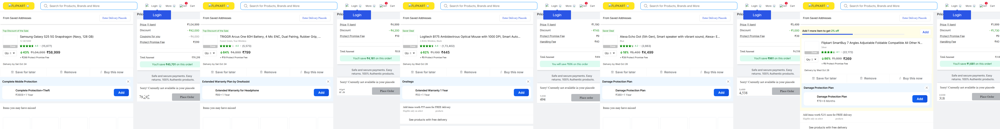

# Flipkart Multithreaded Web Automation Pipeline

A high-performance, concurrent Python automation framework built with **Selenium WebDriver**, **ThreadPoolExecutor**, and **Requests**. It executes multiple independent product automation tasks simultaneously, maintains completely isolated browser sessions, transfers authentication cookies into HTTP sessions to verify status codes, validates product cart presence, and consolidates verified data into structured JSON output.

---

## 📌 Features & Architecture Overview

* **Task 1 — Multithreaded Selenium Concurrency:** Uses Python's `ThreadPoolExecutor` to execute multiple product search and extraction tasks concurrently across independent Google Chrome instances with configurable `max_workers`.
* **Task 2 — Isolated Session & HTTP Requests:** Extracts live cookies from each worker's Selenium instance, transfers them into an isolated `requests.Session()`, and queries public endpoints to record HTTP status codes (`200 OK`).
* **Task 3 — Dynamic Cart Automation & Verification:** Performs DOM interaction to add items to cart, navigates to `/viewcart`, verifies product presence, extracts real-time quantity and cart prices, compares product page price vs. cart price, and confirms `SUCCESS`.
* **Task 4 — Thread Safety & Resource Isolation:** Strict thread isolation where cookies, sessions, and WebDriver instances are never shared. Uses structured worker-level logging (`[Worker-X | Product]`), individual execution timers (`execution_seconds`), and guaranteed `driver.quit()` in `finally` blocks.
* **Task 5 — Combined JSON Output:** Automatically aggregates all worker results into `multithread_results.json` matching the client-specified schema without fabricated or hardcoded data.
* **Task 6 — Submission & Visual Concurrency Proof:** Auto-generates `concurrent_execution.png` capturing concurrent browser execution states.

---

## 📋 Client Tasks Compliance Matrix

| Task | Requirement | Implementation Details | Status |
| :---: | :--- | :--- | :---: |
| **Task 1** | **Multithreaded Automation** | `ThreadPoolExecutor` with configurable `max_workers` (default 3), independent Chrome instances, search and data extraction. | ✅ Complete |
| **Task 2** | **Session & HTTP Verification** | Cookies extracted from Selenium, transferred to isolated `requests.Session()`, public endpoint requested, HTTP 200 recorded. | ✅ Complete |
| **Task 3** | **Cart Automation & Verification** | Selenium UI button click + session sync, `/viewcart` navigation, item match verification, cart price & quantity extraction. | ✅ Complete |
| **Task 4** | **Thread Management & Error Handling** | Isolated try/finally blocks, crash resilience across workers, worker-identified logging, `time.perf_counter()` timing. | ✅ Complete |
| **Task 5** | **JSON Output** | Consolidates all worker results into `multithread_results.json` with `total_tasks`, `successful`, `failed`, and metrics. | ✅ Complete |
| **Task 6** | **Submission Deliverables** | Clean source code, `requirements.txt`, updated `README.md`, sample `multithread_results.json`, and `concurrent_execution.png`. | ✅ Complete |

---

## 🚀 Quick Start (1-Click Run)

No manual virtual environment setup or dependency installation is required. `run.py` handles environment creation and package installation automatically:

```bash
# 1. Open project directory
cd Flipkart_Automation

# 2. Run with default 3 concurrent workers (Samsung mobile, Wireless headphones, Logitech mouse)
python run.py

# 3. Or pass custom keywords:
python run.py -k "Samsung mobile" "Bluetooth speaker" "Laptop stand"

# 4. Or configure concurrent worker count:
python run.py --workers 3

# 5. Run in headless mode:
python run.py --headless
```

---

## 💻 Direct Manual Execution

You can also run `main.py` directly using the virtual environment:

```bash
# Activate virtual environment
# Windows:
.\venv\Scripts\activate
# macOS / Linux:
source venv/bin/activate

# Execute multithreaded automation
python main.py --workers 3
```

### CLI Arguments Reference

| Option | Shorthand | Type | Default | Description |
| :--- | :--- | :--- | :--- | :--- |
| `--workers` | `-w` | Integer | `3` | Number of simultaneous concurrent Chrome browser workers |
| `--keywords` | `-k` | List | 3 default keywords | Product keywords (space or comma-separated) |
| `--headless` | | Flag | `False` | Run Chrome instances in background headless mode |
| `--output` | `-o` | String | `multithread_results.json` | Destination filename for output JSON |

---

## 📊 Sample Output Schema (`multithread_results.json`)

Here is an authentic sample output generated from a live execution of 3 concurrent workers:

```json
{
  "total_tasks": 3,
  "successful": 3,
  "failed": 0,
  "results": [
    {
      "worker_id": 1,
      "product_keyword": "Samsung mobile",
      "product_name": "Samsung Galaxy S25 5G Snapdragon (Navy, 128 GB) (12 GB RAM)",
      "product_price": 58999,
      "cart_price": 58999,
      "cart_total": 59298,
      "quantity": 1,
      "cart_verified": true,
      "http_status": 200,
      "status": "SUCCESS",
      "execution_seconds": 22.52
    },
    {
      "worker_id": 2,
      "product_keyword": "Wireless headphones",
      "product_name": "TRIGGR Arcus One 60H Battery, 4 Mic ENC, Dual Pairing,",
      "product_price": 799,
      "cart_price": 799,
      "cart_total": 818,
      "quantity": 1,
      "cart_verified": true,
      "http_status": 200,
      "status": "SUCCESS",
      "execution_seconds": 21.8
    },
    {
      "worker_id": 3,
      "product_keyword": "Logitech mouse",
      "product_name": "Logitech B175 Ambidextrous Optical Mouse with 1000 DPI,",
      "product_price": 445,
      "cart_price": 445,
      "cart_total": 494,
      "quantity": 1,
      "cart_verified": true,
      "http_status": 200,
      "status": "SUCCESS",
      "execution_seconds": 25.72
    }
  ]
}
```

---

## 📸 Concurrent Browser Execution Proof

The pipeline automatically captures and tiles screenshots from concurrent workers, saved as `concurrent_execution.png`:



---

## 📁 Repository Structure

```text
Flipkart_Automation/
├── run.py                      # 1-Click CLI runner (auto-venv, dependency verification, argument forwarding)
├── main.py                     # Multithreaded engine (ThreadPoolExecutor, isolated workers, JSON consolidation)
├── utils.py                    # Modular helper functions (driver factory, cookie transfer, cart verification)
├── requirements.txt            # Minimal, lightweight dependencies (Selenium, Requests, Webdriver-Manager, Pillow)
├── multithread_results.json    # Sample JSON output containing 3 live product tasks
├── concurrent_execution.png    # Live proof image of concurrent browser execution
├── rules.md                    # Project requirements & task specifications (Tasks 1 to 6)
└── README.md                   # Complete architectural documentation & execution guide
```

---

## 👨‍💻 Developer & Author

**Prince Kirad**  
*Python & Web Automation Engineer*

[](mailto:princekirad11@gmail.com)

> *Engineered for high performance, concurrency safety, clean resource isolation, and production-grade reliability.*